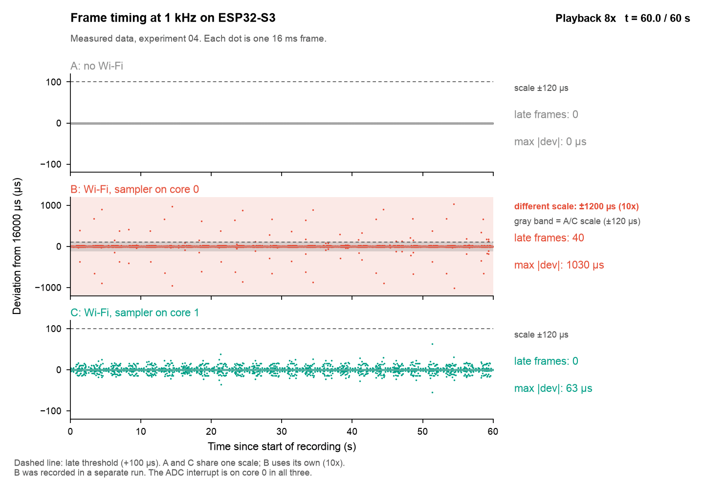
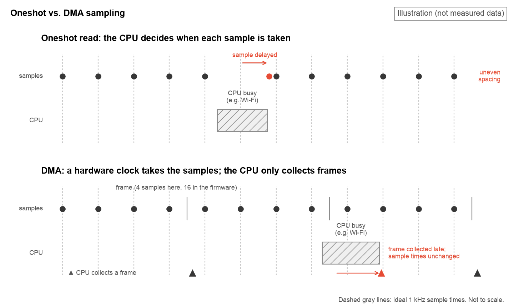

# So I Picked Up Music

An ESP32-S3 + FreeRTOS EMG guitar practice device with measured real-time timing.



Work in progress. Firmware timing experiments are done; EMG input and the browser/WebXR front end are next.

## Key results

Numbers below are from the 60 s per-frame runs of experiment 04 (3750 frames each, one run per condition) unless noted.

- Without Wi-Fi, every frame interval was exactly 16000 µs (3750 of 3750 frames).
- With Wi-Fi scanning and the sampler on core 0 (the Wi-Fi driver's core), frame intervals deviated by up to 1.03 ms and 1.07% of frames were late (40 of 3750).
- With the sampler pinned to core 1, deviations stayed within 63 µs and no frames were late.
- In experiment 03, with the sampler on core 0, one 66.6 ms gap between frames occurred during Wi-Fi start-up, close to the 64 ms DMA buffer.
- No DMA buffer overflows (ovf = 0) occurred in any run of experiments 03 and 04. This is consistent with the ADC being clocked by hardware and DMA buffering the data, so that only the CPU's collection time varies.
- Moving the ADC interrupt to core 1 did not reduce the remaining jitter in one run each. The jitter appears in clusters about 2.5 s apart, close to the average Wi-Fi scan interval of 2.50 s; the cause is still open.
- In experiment 05, the AD8232 module's output reached GPIO4 and responded to the body: mid-range with three electrodes on the skin, with the standard deviation rising from 247 to 667 mV during a fist squeeze (about 5 Hz readings, not a waveform; [notes](docs/experiments/05_ad8232_bringup.md)).



## Firmware experiments

Early bring-up experiments, each a standalone ESP-IDF project under `firmware/experiments/`:

| Folder | Description | Notes |
|---|---|---|
| `01_adc_oneshot` | Stage 0: read a potentiometer on GPIO4 with the oneshot ADC driver to verify wiring and the ADC path. | - |
| `02_adc_dma` | Stage 1: 1 kHz sampling with the continuous (DMA) ADC driver, measuring how regularly frames reach the CPU. | - |
| `03_wifi_interference` | Stage 1b: whether Wi-Fi activity disturbs the 1 kHz DMA sampler's timing, and whether pinning it to core 1 helps. | [Experiment notes](docs/experiments/03_wifi_interference.md) |
| `04_isr_core_affinity` | Stage 1c: whether the core that owns the ADC DMA interrupt affects frame timing jitter. | [Data](docs/data/04_isr_core_affinity/) (notes in progress) |

## Regenerating figures

The figures in `docs/figures/` are generated from the captures in `docs/data/` by the scripts in `analysis/`. They use their own virtual environment, separate from the ESP-IDF Python environment:

```sh
python3 -m venv .venv
.venv/bin/pip install -r analysis/requirements.txt
.venv/bin/python analysis/plot_03_wifi_interference.py
.venv/bin/python analysis/plot_04_isr_core_affinity.py
.venv/bin/python analysis/plot_05_bringup.py
.venv/bin/python analysis/anim_04_timing_replay.py
.venv/bin/python analysis/anim_concept_oneshot_vs_dma.py
```

The two animation scripts compress their GIFs with [gifsicle](https://www.lcdf.org/gifsicle/), which must be installed separately (macOS: `brew install gifsicle`).

Colors, fonts and the white background are shared through `analysis/style.py`.
