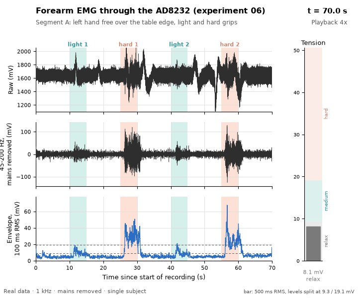

# So I Picked Up Music

An ESP32-S3 firmware and real-time system project: the board measures forearm EMG at 1 kHz under FreeRTOS, computes the fretting hand's tension on the device, and streams it over Wi-Fi to a Mac bridge and a browser (Three.js / WebXR) front end for guitar practice, with measured timing at every step.


Work in progress: the whole pipeline runs end to end on replayed recordings, and the Wi-Fi firmware streams from the board; the level test on the guitar waits for a replacement AD8232 module ([session 1](docs/experiments/08_hardware_session_1.md)). See [Roadmap / status](#roadmap--status).

## Key results

Numbers below are from the 60 s per-frame runs of experiment 04 (3750 frames each, one run per condition) unless noted.

- Without Wi-Fi, every frame interval was exactly 16000 µs (3750 of 3750 frames).
- With Wi-Fi scanning and the sampler on core 0 (the Wi-Fi driver's core), frame intervals deviated by up to 1.03 ms and 1.07% of frames were late (40 of 3750).
- With the sampler pinned to core 1, deviations stayed within 63 µs and no frames were late.
- In experiment 03, with the sampler on core 0, one 66.6 ms gap between frames occurred during Wi-Fi start-up, close to the 64 ms DMA buffer.
- No DMA buffer overflows (ovf = 0) occurred in any run of experiments 03 and 04. This is consistent with the ADC being clocked by hardware and DMA buffering the data, so that only the CPU's collection time varies.
- Moving the ADC interrupt to core 1 did not reduce the remaining jitter in one run each. The jitter appears in clusters about 2.5 s apart, close to the average Wi-Fi scan interval of 2.50 s; the cause is still open.
- In experiment 05, the AD8232 module's output reached GPIO4 and responded to the body: mid-range with three electrodes on the skin, with the standard deviation rising from 247 to 667 mV during a fist squeeze (about 5 Hz readings, not a waveform; [notes](docs/experiments/05_ad8232_bringup.md)).


- In experiment 06, forearm EMG through the same AD8232 module fell into three tension levels once every 60 Hz mains harmonic was removed and only 45-200 Hz kept: relax 4.6-8.1 mV, light grip or G chord 10.5-17.5 mV, hard grip 20.7-32.3 mV RMS (one subject, one day, 2-3 repetitions each; [notes](docs/experiments/06_forearm_emg.md)).




## Roadmap / status

MVP: show relax / medium / hard forearm tension live while playing ([definition of done](docs/mvp.md), [architecture](docs/architecture.md), [protocol](docs/protocol.md)).

Done (tested without hardware, on the experiment 06 recordings):

- [x] Timing experiments 01-04: DMA sampling, Wi-Fi interference, core affinity
- [x] AD8232 bring-up and forearm EMG analysis (05, 06)
- [x] On-board DSP with calibration retry and level hysteresis (07); C output identical in levels to a float64 reference
- [x] Protocol v1 (UDP JSON), replayer through the firmware's own DSP, Mac bridge with loss statistics and session logs
- [x] Browser front end with three feedback designs and live latency readouts
- [x] End-to-end replay test (replay -> bridge -> WebSocket): every message, levels identical to the host test
- [x] Session summary (JSON) and a "letter to future self" prompt (printed only, no model call)

Written, needs hardware ([checklist](docs/hardware_session_checklist.md)):

- [x] Flash 08: Wi-Fi streaming, button, LED, no MAC address in the logs ([session 1](docs/experiments/08_hardware_session_1.md))
- [ ] 08: detect Wi-Fi stalls while associated (seen twice in session 1); replace the AD8232 module
- [ ] Three levels on the guitar with real calibration; new recordings to fix the provisional thresholds
- [ ] End-to-end latency < 300 ms (LED + phone slow motion)
- [ ] 5 min continuous streaming, packet loss < 1 %
- [ ] WebXR AR overlay on Quest

## Replay demo (no hardware)

```sh
python3 -m venv .venv
.venv/bin/pip install -r analysis/requirements.txt
scripts/run_replay_demo.sh          # or: scripts/run_replay_demo.sh 04_B_chord.log 1
```

Open http://localhost:8000/ and switch designs with keys 1 / 2 / 3. The script runs the bridge, a static web server and the replayer (which builds the firmware DSP for the Mac with `make` on first use) (experiment 06 segment A in a loop, real time); Ctrl-C stops everything. Session logs land in `sessions/` (git-ignored):

```sh
.venv/bin/python tools/session_summary.py          # newest session -> JSON statistics
.venv/bin/python tools/letter_prompt.py            # prints the letter prompt; no model is called
.venv/bin/python tests/test_e2e_replay.py          # end-to-end test, about 20 s
```

## Firmware experiments

Early bring-up experiments, each a standalone ESP-IDF project under `firmware/experiments/`:

| Folder | Description | Notes |
|---|---|---|
| `01_adc_oneshot` | Stage 0: read a potentiometer on GPIO4 with the oneshot ADC driver to verify wiring and the ADC path. | - |
| `02_adc_dma` | Stage 1: 1 kHz sampling with the continuous (DMA) ADC driver, measuring how regularly frames reach the CPU. | - |
| `03_wifi_interference` | Stage 1b: whether Wi-Fi activity disturbs the 1 kHz DMA sampler's timing, and whether pinning it to core 1 helps. | [Experiment notes](docs/experiments/03_wifi_interference.md) |
| `04_isr_core_affinity` | Stage 1c: whether the core that owns the ADC DMA interrupt affects frame timing jitter. | [Data](docs/data/04_isr_core_affinity/) (notes in progress) |
| `06_raw_emg_stream` | Stage 2: stream every 1 kHz ADC sample of the AD8232 output to the host for forearm EMG analysis. | [Experiment notes](docs/experiments/06_forearm_emg.md) |
| `07_onboard_tension` | MVP step 1: compute EMG tension on the board (mains notches, 45-200 Hz band-pass, 200 ms RMS, relax calibration, three levels). No Wi-Fi. | [README](firmware/experiments/07_onboard_tension/README.md) |
| `08_wifi_stream` | MVP step 2: the 07 DSP plus Wi-Fi UDP streaming (protocol v1), latency LED and calibration button. **Partly tested on hardware.** | [README](firmware/experiments/08_wifi_stream/README.md) |

## Regenerating figures

The figures in `docs/figures/` are generated from the captures in `docs/data/` by the scripts in `analysis/`. They use their own virtual environment, separate from the ESP-IDF Python environment:

```sh
python3 -m venv .venv
.venv/bin/pip install -r analysis/requirements.txt
.venv/bin/python analysis/plot_03_wifi_interference.py
.venv/bin/python analysis/plot_04_isr_core_affinity.py
.venv/bin/python analysis/plot_05_bringup.py
.venv/bin/python analysis/plot_06_forearm_emg.py
.venv/bin/python analysis/anim_04_timing_replay.py
.venv/bin/python analysis/anim_concept_oneshot_vs_dma.py
.venv/bin/python analysis/anim_05_bringup.py
.venv/bin/python analysis/anim_06_emg.py
```

The animation scripts compress their GIFs with [gifsicle](https://www.lcdf.org/gifsicle/), which must be installed separately (macOS: `brew install gifsicle`).

Colors, fonts and the white background are shared through `analysis/style.py`.
