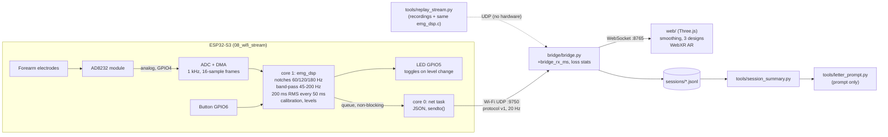

# MVP architecture

The MVP shows the fretting hand's forearm tension while playing guitar: relax, medium or hard, in the browser and (later) as an overlay on a Quest headset. It has three layers:

| Layer | Runs on | Code | Job |
|---|---|---|---|
| Device | ESP32-S3 + AD8232 module | [`firmware/experiments/08_wifi_stream`](../firmware/experiments/08_wifi_stream) (DSP shared with [`07_onboard_tension`](../firmware/experiments/07_onboard_tension)) | Sample the EMG at 1 kHz, compute tension on the board, send one message every 50 ms over Wi-Fi UDP |
| Bridge | Mac | [`bridge/bridge.py`](../bridge/bridge.py) | Receive UDP, count loss, log the session, forward to browsers over WebSocket |
| Front end | Browser (Mac, later Quest) | [`web/`](../web) | Show the level in one of three designs (ring, strip, edge glow) and the measured latency |

Without hardware, [`tools/replay_stream.py`](../tools/replay_stream.py) stands in for the device: it runs the experiment 06 recordings through the same compiled `emg_dsp.c` and sends the same messages. After a session, [`tools/session_summary.py`](../tools/session_summary.py) and [`tools/letter_prompt.py`](../tools/letter_prompt.py) read the bridge's log.

## Data flow

Message format: [protocol.md](protocol.md).

Design decisions:

- **Tension is computed on the board**, not on the Mac: the radio carries 20 small messages per second instead of 1000 samples, and a lost datagram costs 50 ms of level, not a gap in the filter input.
- **Sampling on core 1, network on core 0.** Experiment 03 showed Wi-Fi activity delaying a sampler on core 0 by up to 66.6 ms; on core 1 deviations stayed within 63 µs (experiment 04). The sampler never waits on the network: it hands each hop to a queue without blocking, and drops it (counted) if the queue is full.
- **UDP, no retransmission.** A late tension value is useless for live feedback; loss is visible from `seq` (protocol.md).
- **The bridge is thin.** It forwards each message unchanged; all levels come from the device, so the replay, the board and the session log show the same numbers.

## Latency sources

From a change in muscle tension to a change on screen. "Measured" values come from this repository; the rest are estimates that the hardware session has to confirm.

| Stage | Contribution | Basis |
|---|---|---|
| AD8232 module analog filtering | small (a few ms at most) | **Estimate**; not measured |
| DMA frame collection | 0-16 ms (16 samples per frame at 1 kHz) | Design; frame intervals measured in experiments 02-04 |
| DSP on the board | ~0.1 ms per frame (avg 93 µs, max 173 µs per 16 samples) | **Measured** on the board, experiment 07 |
| Algorithm: filters, 200 ms RMS window, 50 ms hop, hysteresis | onset 122-193 ms, release ~172-185 ms | **Measured offline**: causal level vs a zero-phase offline metric on the experiment 06 recordings (`analysis/validate_07_tension.py`) |
| Queue to network task, `sendto()` | < 1 ms | Estimate |
| Wi-Fi UDP to the Mac | typically a few ms, occasional tens of ms | **Estimate**; Wi-Fi power save is turned off in 08. Not measured |
| Bridge (parse, log, broadcast) | < 1 ms | Estimate; the browser shows bridge -> browser latency live |
| WebSocket to the browser, same Mac | ~1 ms | Shown live in the front end (`bridge -> browser`) |
| Smoothing in the front end (TAU 60 ms) | visible change within one frame; half-way after ~42 ms, 63 % after 60 ms | Design (`web/app.js`) |
| Rendering and display | one frame (16.7 ms at 60 Hz, 11-14 ms at 72-90 Hz on Quest) plus display latency | Estimate; headless Chrome with software rendering measured 53-70 ms browser -> render, not representative of a GPU |

The algorithm dominates: about 120-190 ms is the price of a 200 ms RMS window, which is needed to get a stable level from EMG. Everything after the board is expected to add tens of milliseconds. [mvp.md](mvp.md) sets the end-to-end target from this budget; [hardware_session_checklist.md](hardware_session_checklist.md) describes how to measure the part after the board with the LED and a phone's slow-motion camera.
