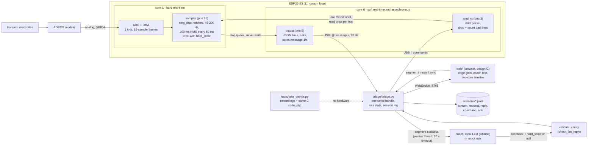

# Architecture

The system shows the fretting hand's forearm tension while playing guitar (relax, medium or hard) in the browser, and between practice segments a language model comments on the segment and may adjust one threshold on the board. Transport is USB; the view is a desktop web page (WebXR-ready: the session code exists but has never been run on a headset).

| Layer | Runs on | Code | Job |
|---|---|---|---|
| Device | ESP32-S3 + AD8232 module | [`firmware/experiments/11_coach_loop`](../firmware/experiments/11_coach_loop) (DSP shared with [`07_onboard_tension`](../firmware/experiments/07_onboard_tension)); [`10_usb_stream`](../firmware/experiments/10_usb_stream) is the same without the downlink | Sample the EMG at 1 kHz, compute tension on the board, send one message every 50 ms over USB, accept parameter commands |
| Bridge | Mac | [`bridge/bridge.py`](../bridge/bridge.py), [`bridge/coach.py`](../bridge/coach.py) | Read and write the serial port, count loss, log the session, forward to browsers; at the end of a segment ask the coach, validate its reply, send the command |
| Coach | Mac | Ollama, `llama3.2:3b` by default (`--llm ollama`), or a fixed rule (`--llm mock`) | One sentence of feedback and at most one `hard_scale` value per segment. Local, no API key |
| Front end | Browser on the Mac | [`web/`](../web) | Edge glow for the level (design C), coach sentence, segment state, the command round trip, and a two-core timeline |

Status: the device layer for the coach loop is **built but not yet run on the board**; everything else in the loop is tested against a simulated device ([`tools/fake_device.py`](../tools/fake_device.py): real recordings and the firmware's C code behind a pseudo-terminal, simulated timing). The one-way USB stream (10) was tested on the board in [session 2](experiments/09_hardware_session_2.md). See [mvp.md](mvp.md).

## Data flow

The older paths still work: `08_wifi_stream` and `tools/replay_stream.py` send the same tension messages over UDP (no downlink), and `tools/session_summary.py` / `tools/letter_prompt.py` read a session log afterwards.

Message formats: [protocol.md](protocol.md).

## Three timing classes

The language model is in the loop, but outside the hard real-time path.

| Class | Where | Deadline | What happens when it is late |
|---|---|---|---|
| Hard real-time | Core 1: ADC + DMA, sampler, DSP | A 16-sample frame must be collected within the 64 ms DMA pool | Samples are lost for good (`ovf`), the filter input has a hole |
| Soft real-time | Core 0 `output`, USB, bridge, WebSocket, browser | A tension message every 50 ms; target < 300 ms end to end ([mvp.md](mvp.md)) | The display lags or skips a message (`drop`, `lost`); the measurement is unaffected |
| Asynchronous | Core 0 `cmd_rx`, the coach (0.7-7 s per reply measured with `llama3.2:3b`, 10 s timeout), the command and its ack | None. A reply is useful whenever it comes | Nothing is lost: the stream continues, and after the timeout the previous feedback is shown, marked as fallback |

How the classes are kept apart:

- The sampler never waits for anything except the ADC. It hands hops to a queue without blocking and reads parameters from one 32-bit word (a generation counter and `hard_scale`), which the command task writes with a single store. No lock is shared with the sampling path.
- A new parameter takes effect on a hop boundary, so every level is computed with one consistent value, and the ack names the first hop that used it.
- The bridge calls the model in a worker thread; the serial reader and the WebSocket side keep running.
- The model's reply is data, not code: one sentence and one number, checked against a schema and a range on the Mac and again on the board.

`mode = naive` exists to show the difference: the sampler waits for the reply itself, as a single loop would. In the simulated device the stream then stops for the whole thinking time and the samples of that time are lost; in designed mode the longest pause between two messages was 20 ms at 4x playback, where one hop is 12.5 ms (`tests/test_e2e_coach.py`). On the board this comparison has not been run yet.

Design decisions:

- **Tension is computed on the board**, not on the Mac: the link carries 20 small messages per second instead of 1000 samples, and a lost message costs 50 ms of level, not a gap in the filter input.
- **Sampling on core 1, everything that talks to the host on core 0.** Experiment 03 showed Wi-Fi activity delaying a sampler on core 0 by up to 66.6 ms; on core 1 deviations stayed within 63 µs (experiment 04).
- **USB, not Wi-Fi, for now.** With Wi-Fi on, the relaxed-forearm RMS rose from 6.5 to 15.5 mV and calibration failed ([session 2](experiments/09_hardware_session_2.md#2-07-vs-08-wi-fi-raises-the-noise)). This is an open problem.
- **The bridge is thin for the stream.** It forwards each device message unchanged; all levels come from the device, so the simulation, the board and the session log show the same numbers.
- **The model is local.** No practice data leaves the Mac and no API key is needed.

## Latency sources

From a change in muscle tension to a change on screen. "Measured" values come from this repository; the rest are estimates that the hardware session has to confirm.

| Stage | Contribution | Basis |
|---|---|---|
| AD8232 module analog filtering | small (a few ms at most) | **Estimate**; not measured |
| DMA frame collection | 0-16 ms (16 samples per frame at 1 kHz) | Design; frame intervals measured in experiments 02-04 |
| DSP on the board | ~0.1 ms per frame (avg 93 µs, max 173 µs per 16 samples) | **Measured** on the board, experiment 07 |
| Algorithm: filters, 200 ms RMS window, 50 ms hop, hysteresis | onset 122-193 ms, release ~172-185 ms | **Measured offline**: causal level vs a zero-phase offline metric on the experiment 06 recordings (`analysis/validate_07_tension.py`) |
| Queue to the output task, USB write | < 1 ms | Estimate |
| USB serial to the Mac | not measured | Over Wi-Fi UDP (08): estimated a few ms, occasional tens of ms |
| Bridge (parse, log, broadcast) | < 1 ms | Estimate; the browser shows bridge -> browser latency live |
| WebSocket to the browser, same Mac | ~1 ms | Shown live in the front end (`bridge -> browser`) |
| Smoothing in the front end (TAU 60 ms) | visible change within one frame; half-way after ~42 ms, 63 % after 60 ms | Design (`web/app.js`) |
| Rendering and display | one frame (16.7 ms at 60 Hz, 11-14 ms at 72-90 Hz on Quest) plus display latency | Estimate; headless Chrome with software rendering measured 53-70 ms browser -> render, not representative of a GPU |

The algorithm dominates: about 120-190 ms is the price of a 200 ms RMS window, which is needed to get a stable level from EMG. Everything after the board is expected to add tens of milliseconds. The coach is not part of this path: its reply arrives seconds after a segment ends and changes only the next segment's threshold. [mvp.md](mvp.md) sets the end-to-end target from this budget; [hardware_session_checklist.md](hardware_session_checklist.md) describes how to measure the part after the board with the LED and a phone's slow-motion camera.
