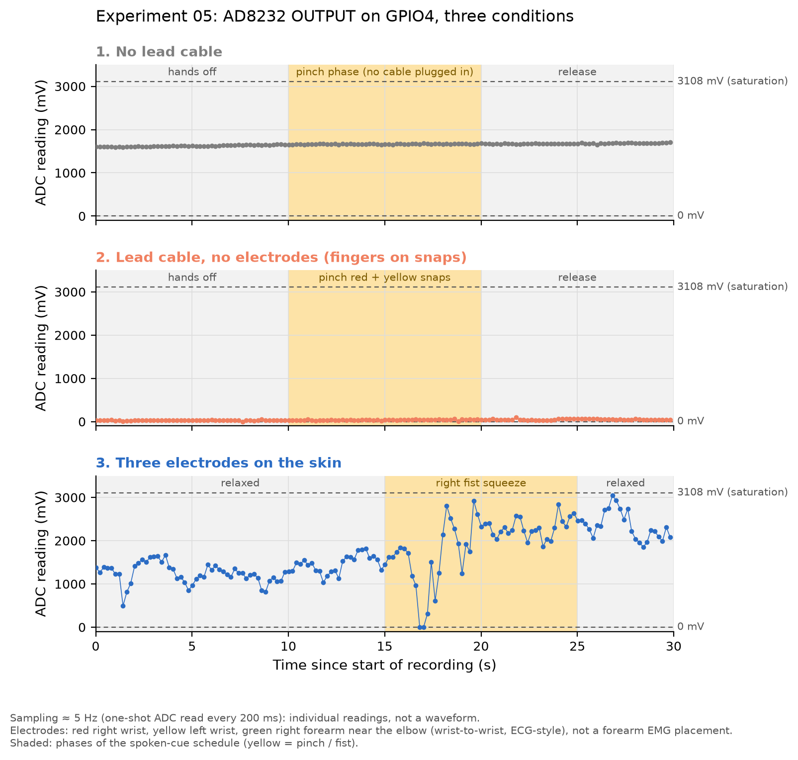
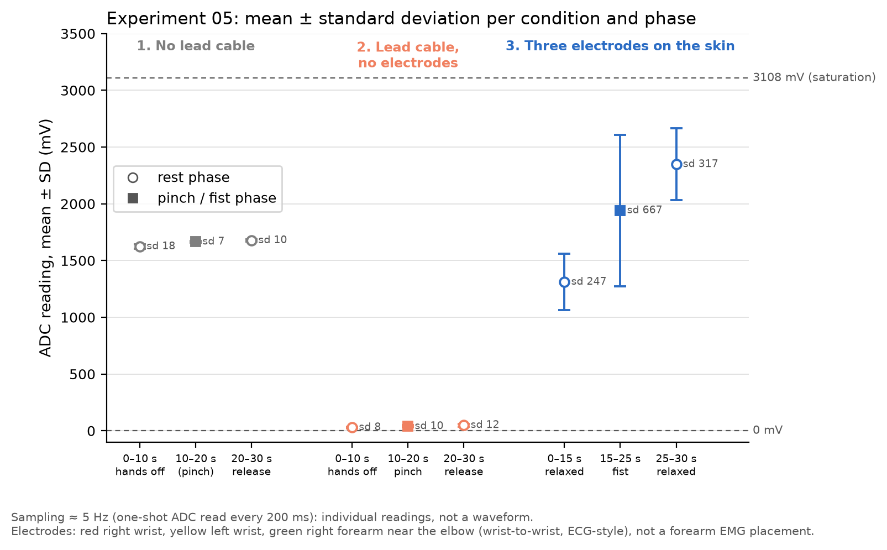
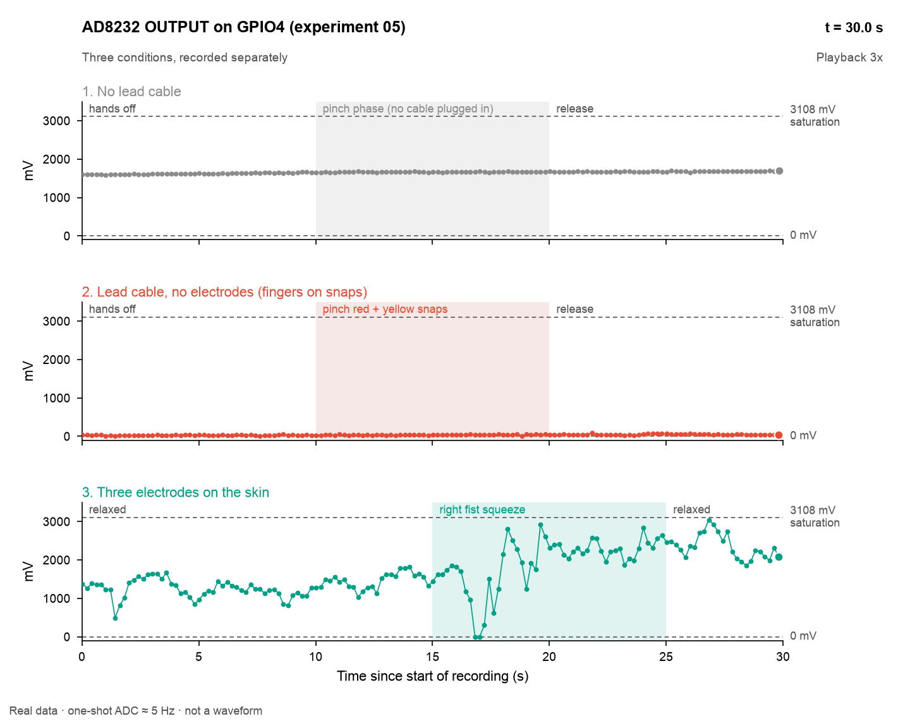

# Experiment 05: AD8232 bring-up and first body-signal check

## 1. Question

Is the AD8232 module powered and working, and does its OUTPUT pin actually reach GPIO4 (ADC1 channel 3) of the ESP32-S3?

## 2. Setup

| Item | Value |
|---|---|
| Board | ESP32-S3 N16R8 (firmware uses the default 2 MB flash setting; PSRAM not enabled) |
| Analog front end | AD8232 single-lead heart-rate monitor module |
| Wiring | AD8232 3.3v -> ESP32-S3 3V3, GND -> GND, OUTPUT -> GPIO4. LO+, LO- and SDN not connected |
| Firmware | `firmware/experiments/01_adc_oneshot`, unchanged (built at commit `eedde22`) |
| ADC | Oneshot read, 12 dB attenuation, curve-fitting calibration to mV. Largest calibrated reading 3108 mV (saturation) |
| Sampling | One read every 200 ms, about 5 Hz |
| Serial | Native USB (USB-Serial-JTAG) port |
| Capture | [`analysis/record_serial.py`](../../analysis/record_serial.py), 30 s per condition, one run per condition, spoken cues (macOS `say`) |
| Date | 2026-10-12 |

Conditions, recorded in this order within about 7 minutes:

| | Lead cable | Body contact | Schedule | Data |
|---|---|---|---|---|
| 1. No lead cable | Not plugged in | None | 0-10 s hands off / 10-20 s pinch phase / 20-30 s release | [no_lead.log](../data/05_ad8232_bringup/no_lead.log) |
| 2. Lead cable, no electrodes | Plugged in | Fingers pinching the red and yellow snaps in 10-20 s | Same as 1 | [lead_no_electrodes.log](../data/05_ad8232_bringup/lead_no_electrodes.log) |
| 3. Three electrodes | Plugged in | Adhesive electrode pads: red on the right wrist, yellow on the left wrist, green on the right forearm near the elbow; skin wiped with alcohol | 0-15 s relaxed / 15-25 s right fist squeeze / 25-30 s relaxed | [electrodes.log](../data/05_ad8232_bringup/electrodes.log) |

In condition 1 there was no cable to pinch; its phases are kept only so the three runs line up.

## 3. Method

- Each log line is `<seconds since recording start>\t<serial line>`. The board reset when the port was opened, so every log starts with a boot log.
- Lines the board printed before the recording started reach the host together near t = 0, so the host arrival time is not used for timing. Instead, each reading's board timestamp is mapped onto the recording time using the offset between the two clocks measured on lines that arrived live (transfer delay at most 10 ms). Readings from before t = 0 are dropped (24 per log), leaving 150 readings per log.
- Phases follow the spoken-cue schedule. The person's reaction time after each cue was not measured.
- "Mean step" is the mean absolute difference between consecutive readings that are both inside the phase.
- Statistics and figures are produced by [`analysis/plot_05_bringup.py`](../../analysis/plot_05_bringup.py).

## 4. Results

| Condition | Phase | n | Mean (mV) | Min (mV) | Max (mV) | SD (mV) | Mean step (mV) |
|---|---|---|---|---|---|---|---|
| 1. No lead cable | 0-10 s hands off | 50 | 1624.0 | 1589 | 1664 | 18.4 | 6.3 |
| 1. No lead cable | 10-20 s pinch phase (no cable) | 50 | 1665.5 | 1647 | 1679 | 7.3 | 7.4 |
| 1. No lead cable | 20-30 s release | 50 | 1677.6 | 1653 | 1703 | 10.0 | 8.1 |
| 2. Lead cable, no electrodes | 0-10 s hands off | 50 | 30.0 | 2 | 59 | 7.8 | 6.7 |
| 2. Lead cable, no electrodes | 10-20 s pinch red + yellow snaps | 50 | 39.8 | 13 | 63 | 9.6 | 7.8 |
| 2. Lead cable, no electrodes | 20-30 s release | 50 | 49.9 | 31 | 95 | 12.3 | 6.6 |
| 3. Three electrodes | 0-15 s relaxed | 75 | 1311.5 | 495 | 1819 | 247.0 | 123.6 |
| 3. Three electrodes | 15-25 s right fist squeeze | 50 | 1941.4 | 0 | 2925 | 666.7 | 318.6 |
| 3. Three electrodes | 25-30 s relaxed | 25 | 2348.2 | 1855 | 3044 | 316.7 | 181.0 |

Replay of the same readings at 3x speed ([`analysis/anim_05_bringup.py`](../../analysis/anim_05_bringup.py)):

Sampling is about 5 Hz (one-shot reads), so these are individual readings, not a waveform. The electrode placement was wrist-to-wrist (ECG-style), not a forearm EMG placement.

## 5. Interpretation

- **GPIO4 is connected to OUTPUT.** Plugging in the lead cable, with nothing else changed, moved the reading from about 1.6 V (phase means 1624-1678 mV) to about 0.04 V (phase means 30-50 mV). A floating GPIO4 would not respond to a cable plugged into the module, so the reading must come from the AD8232 output. Condition 1 alone could not show this: a floating ADC input can also read a drifting mid-range value.
- **Fingers on two snaps leave the output at the low end.** With the cable plugged in, pinching only the red and yellow snaps kept the reading near 0 (pinch-phase mean 39.8 mV, max 63 mV); the slow rise from 30 to 50 mV across the run continued after release, so it cannot be attributed to the pinch. This is consistent with the amplifier saturating at its low side, because there was no right-leg (RL) reference and dry fingers on metal snaps give a high contact impedance. This explanation was not verified (LO+ and LO- were not measured).
- **With three electrodes the output returns to mid-range and responds to a fist squeeze.** Relaxed, the reading averaged 1311.5 mV with SD 247.0 mV. During the right fist squeeze the SD rose to 666.7 mV and the mean step from 123.6 to 318.6 mV. This shows the module is powered, the chip is working and the whole path from electrodes to GPIO4 carries a body signal. At 5 Hz it does not show what that signal is (see limitations).

## 6. Limitations

- About 5 Hz sampling cannot show an ECG or EMG waveform (surface EMG content is roughly 20-450 Hz). The readings are effectively random samples of a faster signal plus its baseline.
- During the fist squeeze the reading hit 0 mV (two readings) and 2925 mV, and the next relaxed phase reached 3044 mV, close to the 3108 mV limit. The signal may be clipping. The AD8232 is designed for ECG; the common module design (SparkFun reference) uses a gain of about 1100, which may be too high for EMG. The gain of this module was not measured.
- After the squeeze the baseline did not return within 5 s (relaxed-phase mean 2348.2 mV vs 1311.5 mV before). The common module design has a high-pass filter around 0.5 Hz, which settles slowly; this cut-off was not measured on this module.
- The wrist-to-wrist placement picks up ECG and motion as well as forearm muscle activity, so the change during the squeeze cannot be attributed to EMG alone.
- One 30 s run per condition. The three runs were recorded separately, not simultaneously.

## 7. Next steps

- Forearm EMG placement: two electrodes along the forearm flexors about 2 cm apart, and the reference electrode on the bony point of the elbow.
- Sample at 1 kHz with the DMA driver (as in experiments 02-04) to see the actual waveform and how much of it clips.
