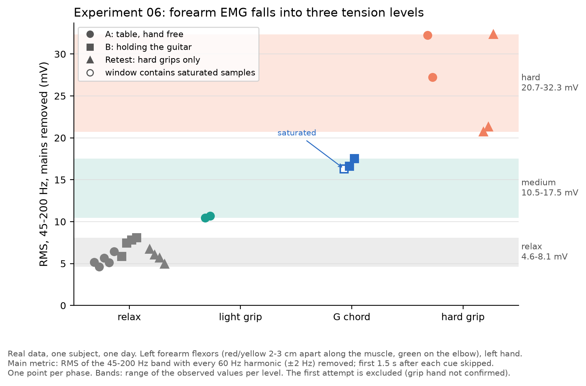
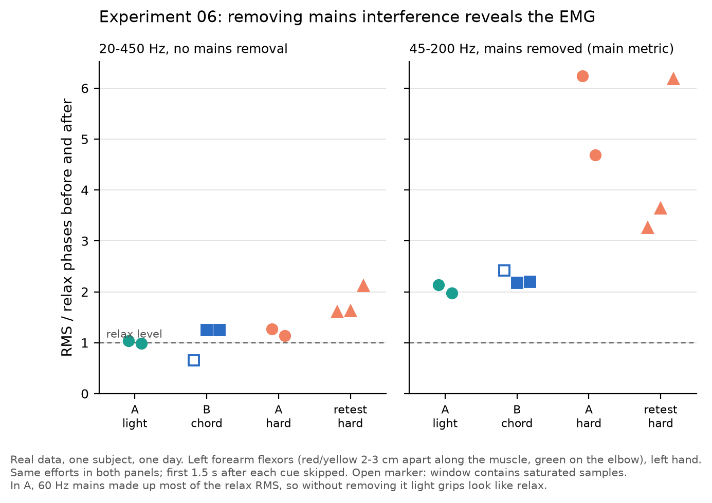
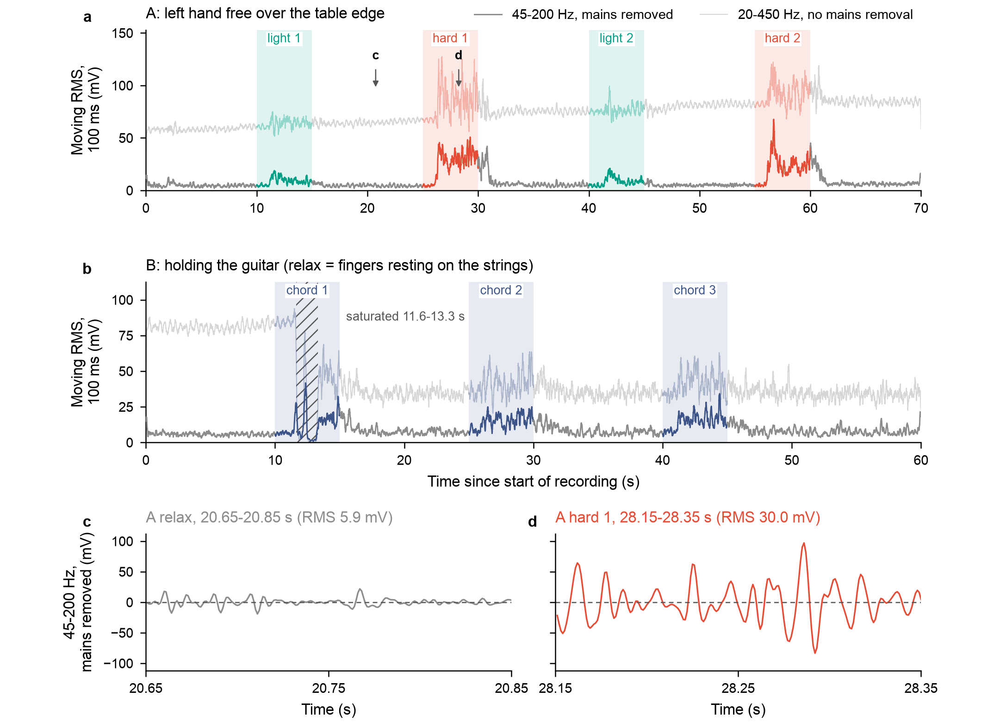
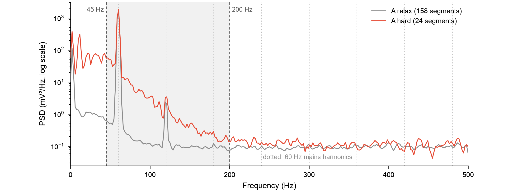
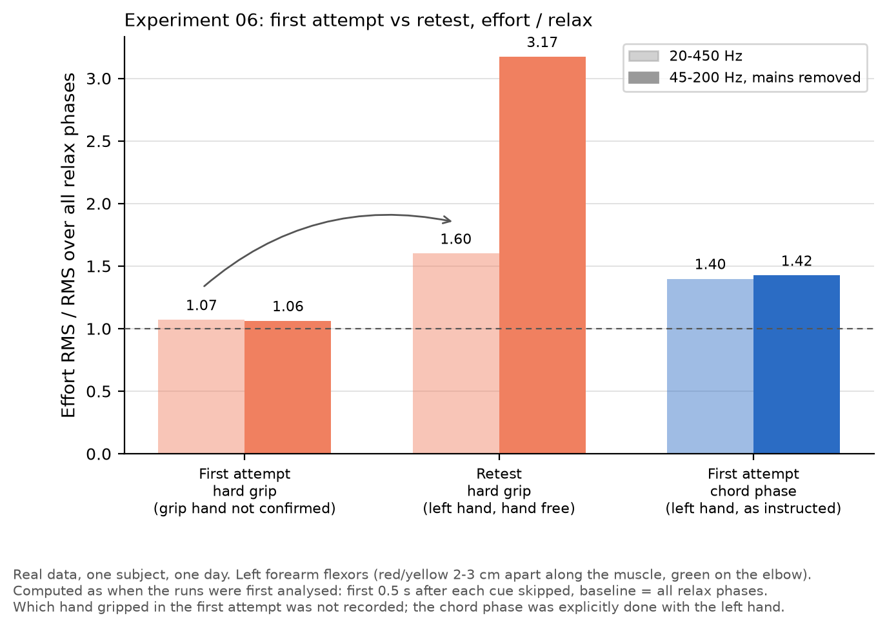

# Experiment 06: Forearm EMG with the AD8232 module (three tension levels)

## 1. Question

Can the AD8232 module (an ECG front end) measure forearm muscle activity well enough to show how tense the fretting hand is, and which signal processing does that need?

## 2. Setup

| Item | Value |
|---|---|
| Board | ESP32-S3 N16R8 (firmware uses the default 2 MB flash setting; PSRAM not enabled) |
| Analog front end | AD8232 single-lead heart-rate monitor module, same module as experiment 05 |
| Wiring | AD8232 3.3v -> ESP32-S3 3V3, GND -> GND, OUTPUT -> GPIO4 (ADC1 channel 3). LO+, LO- and SDN not connected |
| Electrodes | Adhesive pads on the left forearm flexors: red and yellow 2-3 cm apart along the muscle, green on the bony point of the elbow |
| Firmware | [`firmware/experiments/06_raw_emg_stream`](../../firmware/experiments/06_raw_emg_stream) |
| Capture | [`analysis/record_serial.py`](../../analysis/record_serial.py) over the native USB port, spoken cues (macOS `say`) |
| Subject / date | One subject, 2026-10-12 |

Firmware `06_raw_emg_stream`:

- ADC continuous (DMA) driver, 1 kHz, 12 dB attenuation, 16 samples per frame; every sample converted to mV with the curve-fitting calibration.
- The sampler task runs on core 1 (experiment 03), priority 10. Wi-Fi is not started.
- Every sample is sent as `<sample index>,<mV>`. Sample time is `index / 1000 s`, i.e. the ADC hardware clock, not the time the CPU received the frame.
- Once per second a `# samples= ovf= dropped= bad=` line reports DMA overflows, samples dropped on the way to the serial port, and results from an unexpected channel.
- The sampler never waits on the serial port: it hands each frame to a queue without blocking. A lower-priority output task on core 0 formats the lines and writes them through the USB-Serial-JTAG driver (8 KB TX buffer).
- The console runs on USB-Serial-JTAG only. On UART at 115200 baud (about 11.5 kB/s) the stream of about 12 kB/s would block.

## 3. Recordings

All four runs used the same firmware and the left forearm. Data are in [`docs/data/06_forearm_emg/`](../data/06_forearm_emg/).

| # | Recording | Posture | Cue schedule (s) | Data |
|---|---|---|---|---|
| 1 | First attempt | Forearm resting on the table | 0 relax, 10 light, 15 relax, 25 hard, 30 relax, 40 chord (left hand: G chord, or fingertips pressed on the table without a guitar), 50 relax | [01_first_attempt.log](../data/06_forearm_emg/01_first_attempt.log) |
| 2 | Retest | Left hand free over the table edge, touching nothing | 0 relax, 10 hard, 15 relax, 25 hard, 30 relax, 40 hard, 45 relax | [02_retest_hard.log](../data/06_forearm_emg/02_retest_hard.log) |
| 3 | A | Left hand free over the table edge | 0 relax, 10 light, 15 relax, 25 hard, 30 relax, 40 light, 45 relax, 55 hard, 60 relax (70 s) | [03_A_light_hard.log](../data/06_forearm_emg/03_A_light_hard.log) |
| 4 | B | Holding the guitar; relax = fingers resting on the strings | 0 relax, 10 chord (press a G chord hard), 15 relax, 25 chord, 30 relax, 40 chord, 45 relax | [04_B_chord.log](../data/06_forearm_emg/04_B_chord.log) |

Light = about half strength; hard = full strength. Which hand gripped in the first attempt was not recorded; its chord phase was explicitly done with the left hand. The pads were removed after the retest, so A and B used a new set (the same set for both); whether the first attempt and the retest shared one set was not recorded.

Data integrity (run after the last board reset; see Method):

| Recording | Samples in the recording | Index gaps | ovf / dropped / bad | Saturated samples |
|---|---|---|---|---|
| First attempt | 59,984 | 0 | 0 / 0 / 0 | 0 |
| Retest | 59,986 | 0 | 0 / 0 / 0 | 0 |
| A | 69,999 | 0 | 0 / 0 / 0 | 0 |
| B | 59,989 | 0 | 0 / 0 / 0 | 1,526 (11.6-13.3 s, first chord) |

## 4. Method

- The board resets when the port is opened, and the start of each log can contain lines buffered from the previous run. Only the run after the last reset is used. Time comes from the sample index; its offset to the recording clock is measured on lines that arrived live (transfer delay at most about 20 ms).
- A sample at or below 5 mV or at or above 3100 mV counts as saturated (largest calibrated reading 3108 mV).
- **Main metric:** RMS of the signal band-passed to 45-200 Hz with every 60 Hz mains harmonic (±2 Hz) removed. Both are zero-phase FFT masks (numpy only).
  - 45 Hz lower edge: most motion artefact lies below it.
  - 200 Hz upper edge: above about 200 Hz the spectrum is a flat floor that does not change with effort (figure 4).
  - Mains removal: in A, 60 Hz harmonics dominated the relax signal (section 6).
- The first 1.5 s after every cue is skipped: in the retest, grip onset lagged the cue by 1.2-1.65 s and release by 0.9-1.0 s.
- Each effort is compared with the relax phases right before and after it.
- Scripts: [`analysis/emg.py`](../../analysis/emg.py) (loading and filters), [`analysis/plot_06_forearm_emg.py`](../../analysis/plot_06_forearm_emg.py) (figures and tables below), [`analysis/anim_06_emg.py`](../../analysis/anim_06_emg.py), and the per-recording analyses `analyze_06_emg.py`, `analyze_06_retest.py`, `analyze_06_AB.py`.

## 5. Results

*Main-metric RMS (45-200 Hz, every 60 Hz harmonic removed) of every phase in the retest (triangles), A (circles) and B (squares), first 1.5 s after each cue skipped. Colours: relax gray, light grip teal, G chord blue, hard grip red. Bands: range of the observed values per level. Open square: the first chord in B, whose window contains saturated samples. The first attempt is excluded (grip hand not confirmed).*

Every effort (main metric):

| Recording | Effort | Window (s) | Saturated samples | RMS 45-200 Hz, mains removed (mV) | / neighbouring relax | RMS 20-450 Hz / neighbouring relax |
|---|---|---|---|---|---|---|
| First attempt | light | 11.5-15 | 0 | 19.6 | 0.98 | 1.01 |
| First attempt | hard | 26.5-30 | 0 | 21.6 | 1.03 | 1.08 |
| First attempt | chord | 41.5-50 | 0 | 29.9 | 1.43 | 1.39 |
| Retest | hard 1 | 11.5-15 | 0 | 20.7 | 3.25 | 1.61 |
| Retest | hard 2 | 26.5-30 | 0 | 21.3 | 3.64 | 1.63 |
| Retest | hard 3 | 41.5-45 | 0 | 32.3 | 6.18 | 2.12 |
| A | light 1 | 11.5-15 | 0 | 10.5 | 2.14 | 1.03 |
| A | hard 1 | 26.5-30 | 0 | 32.2 | 6.24 | 1.27 |
| A | light 2 | 41.5-45 | 0 | 10.7 | 1.98 | 0.99 |
| A | hard 2 | 56.5-60 | 0 | 27.2 | 4.68 | 1.14 |
| B | chord 1 | 11.5-15 | 1,526 | 16.3 | 2.42 | 0.66 |
| B | chord 2 | 26.5-30 | 0 | 16.6 | 2.18 | 1.25 |
| B | chord 3 | 41.5-45 | 0 | 17.5 | 2.19 | 1.25 |

Relax phases, RMS 45-200 Hz with mains removed: retest 6.7, 6.0, 5.7, 4.9 mV; A 5.2, 4.6, 5.7, 5.1, 6.4 mV; B 5.9, 7.5, 7.8, 8.1 mV; first attempt 19.3, 20.5, 21.5, 20.3 mV.

Levels observed in the retest, A and B (first attempt excluded):

| Level | Phases | RMS range (mV) |
|---|---|---|
| Relax | all relax phases | 4.6-8.1 |
| Medium | light grips (A), G chords (B) | 10.5-17.5 |
| Hard | hard grips (A, retest) | 20.7-32.3 |

*Each effort's RMS divided by the RMS of the relax phases right before and after it, for the same efforts in both panels. **a**, 20-450 Hz band-pass without mains removal. **b**, main metric (45-200 Hz, 60 Hz harmonics removed). In A, 60 Hz mains made up most of the relax RMS, so in **a** light grips look like relax. Open square: window contains saturated samples. Dashed line: relax level (1).*

***a**, **b**, 100 ms moving RMS of segment A and B: solid, main metric; faint, 20-450 Hz without mains removal. Traces are coloured by cued phase (relax gray, light grip teal, G chord blue, hard grip red); grip onset and release lagged the cues by about 1-1.6 s, so some activity just after a phase is drawn gray. Hatched: samples at the ADC rails in B's first chord. **c**, **d**, 0.2 s of the main-metric signal (45-200 Hz, 60 Hz harmonics removed) from A, same y-axis: a relax phase (20.65-20.85 s) and hard grip 1 (28.15-28.35 s). Each window is centred in its phase's analysis window (first 1.5 s after the cue skipped); arrows in **a** mark where they come from.*

*Welch PSD of segment A at relax (gray) and during hard grips (red); Hann window, 512 samples, 50 % overlap, first 1.5 s after each cue skipped. Gray band and dashed lines: 45-200 Hz used for the main metric. Dotted: 60 Hz mains harmonics.*

Replay of segment A and then segment B at 4x speed ([`analysis/anim_06_emg.py`](../../analysis/anim_06_emg.py)). The tension bar uses a 500 ms RMS of the main-metric signal. Its levels are set per segment, relative to that segment's own relax RMS: medium from 1.49x and hard from 2.72x, the factors lying halfway between relax and the weakest medium effort, and between the strongest medium and the weakest hard effort (effort/relax ratios from the table above, saturated window excluded). For A (relax 5.4 mV) this gives 8.1 and 14.8 mV; for B (relax 7.5 mV) 11.1 and 20.4 mV. Traces are coloured by cued phase, as in the envelope figure. Hatched in B: the saturated part of the first chord.

## 6. How the method was found

1. **First attempt: no difference.** Light and hard grips were within 0.98-1.08 of relax under every metric (table above).
2. **Retest with the left hand, hand free.** Hard grips rose to 1.60 times relax in plain 20-450 Hz RMS (0.5 s skip, all relax phases as baseline, as first analysed).
3. **A: light and hard almost vanished again in plain RMS** (0.99-1.27). Removing the 60 Hz harmonics lowered A's relax RMS (20-450 Hz) from 73.8 to 8.7 mV, an 88 % drop in RMS, i.e. about 99 % of the relax power was mains. The mains level also grew during the run (relax RMS 58.8 -> 84.6 mV). With mains removed and the band limited to 45-200 Hz, light grips were about 2 times and hard grips 4.7-6.2 times their neighbouring relax.
4. **The main metric was adopted** for all recordings. The same removal lowered relax RMS from 27.5 to 12.5 mV in the retest and from 48.2 to 15.8 mV in B.

*Effort RMS divided by the RMS over all relax phases, computed as when the runs were first analysed (first 0.5 s after each cue skipped). Light bars: 20-450 Hz; dark bars: main metric. Red: hard grips; blue: the first attempt's chord phase, done with the left hand as instructed. Which hand gripped in the first attempt was not recorded.*

## 7. Interpretation

**Evidence:**
- With the main metric, every effort in the retest, A and B is 1.98-6.24 times its neighbouring relax, and the three effort types sort into three non-overlapping ranges: relax 4.6-8.1, medium (light grip or G chord) 10.5-17.5, hard 20.7-32.3 mV.
- Light grips were consistent (10.5, 10.7 mV); G chords too (16.6, 17.5 mV, plus 16.3 mV in the saturated first chord). Hard grips varied more (20.7-32.3 mV).
- In A's spectrum, hard grips raise the power above relax at every frequency below about 200 Hz; above about 200 Hz relax and hard are the same flat floor.
- Plain 20-450 Hz RMS does not separate light grips from relax in A (0.99-1.03), because mains dominated it.

**Inference (not verified):**
- The first attempt most likely recorded the wrong arm: the grips were probably made with the right hand while the electrodes were on the left forearm. Supporting this, the only phase that rose in the first attempt was the chord, which was explicitly done with the left hand (1.43). Its relax level (19.3-21.5 mV) was also about 2.4-4.7 times the later runs (4.6-8.1 mV), perhaps because the forearm rested on the table.
- The flat floor above about 200 Hz is consistent with the module's low-pass filter (around 40 Hz in the common reference design) pushing the higher EMG content below the noise; the filter was not measured on this module.
- Why mains interference was so strong, and why it grew during A, was not measured (cable routing, posture or nearby equipment are candidates).
- The chord sits between light and hard grips in absolute RMS but has about the same ratio to its relax as a light grip, because B's relax level (5.9-8.1 mV) was higher than A's (4.6-6.4 mV).

## 8. What this means for the firmware

- **60 Hz notch** on every mains harmonic: without it, the mains signal swamps the EMG.
- **45-200 Hz band-pass** for the tension metric: lower frequencies carry motion artefact, higher ones only noise with this module.
- **Relax baseline per session:** relax levels ranged from 4.6 to 8.1 mV between pads and postures (about 20 mV in the first attempt), and the gaps between levels are only 2.4 mV (relax/medium) and 3.2 mV (medium/hard). A short relaxed calibration at the start of each session is needed before thresholds mean anything.
- **Saturation detection:** pressing the first chord in B drove the output to 0 and then to 3108 mV for 1.7 s. Readings at the rails should be flagged and their windows ignored.
- **Settling time after placing pads:** before these runs, a 10 s check right after placing new pads read 3108 mV throughout; after waiting about 30 s the output was mid-range.

## 9. Limitations

- One subject, one day, two or three repetitions per effort type. The level ranges are observed values, not validated thresholds.
- The grip hand in the first attempt was not recorded.
- No usable EMG above about 200 Hz with this module, narrower than the usual 20-450 Hz surface-EMG band.
- The cause of the strong and changing mains interference was not measured.
- The first chord in B saturated (1,526 samples, 11.6-13.3 s); the relax level after it was higher than before.
- Effort phases follow spoken cues; actual onset lagged the cue by about 1-1.6 s and was only measured in the retest. The 1.5 s skip and the 5 s effort phases leave 3.5 s per effort.
- The retest used a different set of pads from A and B, so absolute RMS values across these runs are compared with that caveat.
